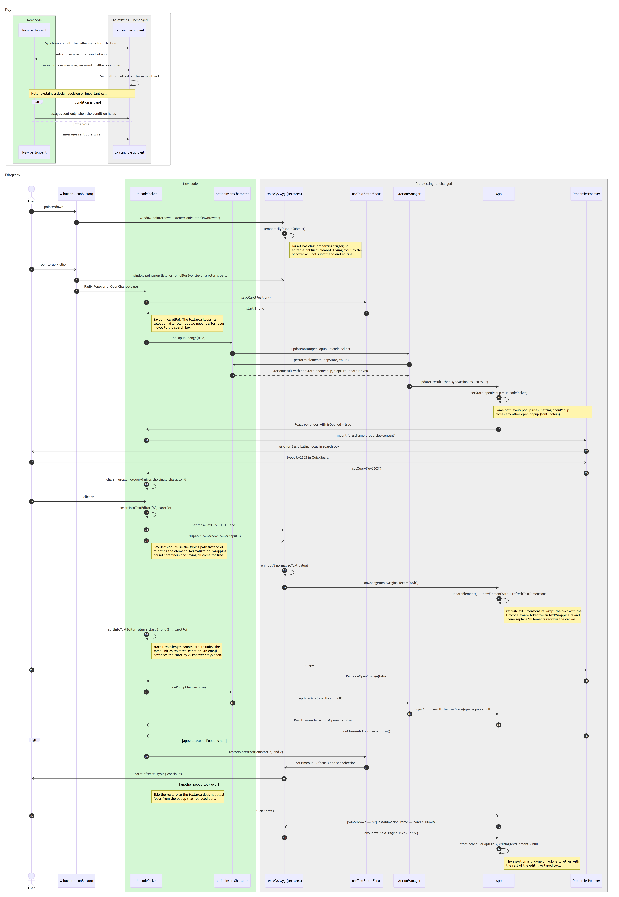

# Issue #138: Insert special character (Unicode picker)

Each diagram image starts with a key that explains its arrows and colours.

## Class diagram

`UnicodePickerHelpers` is not a real class. It stands for the module-level functions exported from `UnicodePicker.tsx`. `textWysiwyg` and `useTextEditorFocus` are likewise modules of functions and closures, shown as classes to make their members visible.

## Sequence diagram

Scenario: the user is editing the text `ab` with the caret between `a` and `b`, opens the picker, inserts ☃ by code point, then presses Escape.

The numbers on the arrows give the order of the messages.

---

## Q&A

**Class Diagram**

1. Among all the classes shown in the diagram, which 1–2 are most central to understanding the codebase and solving the issue? Explain what role each one plays.

   `UnicodePicker` and `textWysiwyg` are the most central. 
   
   `UnicodePicker` is the new component that is the core of the solution. It shows the character chart, keeps the browsing state (block, page, search query), remembers where the caret was when the special character menu is opened (`caretRef`), and inserts the chosen character through `insertIntoTextEditor`. 
   
   `textWysiwyg` is the existing text editor, a `<textarea>` placed over the canvas while a text element is edited. The way that the solution that `UnicodePicker` implemented functions is based on `textWysiwyg` since its rules decide how any toolbar control can work during editing (which includes our solution of adding the ability for users to pick and insert a unicode character). It submits and closes the editor when the textarea loses focus, unless the click landed on an element marked `properties-trigger` or inside `properties-content`. Its `oninput` handler is also the single path through which typed text reaches the element.

2. What is the most significant relationship shown in the diagram? Explain what it represents in the system and why it matters for understanding the solution.

   The most significant relationship is the dependency `UnicodePickerHelpers ..> textWysiwyg` (`setRangeText` + `input` event). It shows that the picker never edits the text element itself. It changes the textarea's value at the caret and fires a synthetic `input` event, so the editor's existing chain `oninput → onChange → App.updateElement → refreshTextDimensions` handles the rest, exactly as if the user had typed the character. This matters because it explains why the editor, the element model and the renderer needed no changes. Inserted characters are normalized, re-wrapped by the Unicode-aware wrapper, saved, and undone together with the rest of the edit for free. The other side of the same idea is `textWysiwyg ..> PropertiesPopover`: the editor checks the `properties-content` class, which is how the picker can take focus without ending the edit.

3. Looking back at your implementation, is there anything in this design you would change, and why?

   Both relationships above work through the DOM rather than through typed code. `insertIntoTextEditor` finds the editor with `document.querySelector(".excalidraw-wysiwyg")`, and the editor recognizes toolbar controls by the strings `properties-trigger` and `properties-content`. If either class name changed, nothing would fail to compile; the picker would just stop working. I would add a small explicit API instead, for example an `insertText(text)` method that the text editor exposes through `App`, and a shared constant for the class names. I would also consider allowing the user to insert a special character from the menu into a selected text element that is not being edited (appending to `originalText` with an undo entry) and make the button to pick and insert a special character visible when a text element is selected, since the button is currently only shown during editing. Finally, searching by character name ("snowman") would make the picker much easier to use, but it needs Unicode's name data (about 1–2 MB), so it should be loaded lazily.

**Sequence Diagram**

1. What user action or system event starts the sequence, and what is the expected outcome when it completes successfully?

   The sequence starts when the user, while editing a text element, clicks the Ω "Insert special character" button. The expected outcome is:
   - the popover opens and the text element stays in editing mode;
   - choosing ☃ inserts it at the caret, so `ab` (if the carat is in between the `a` and `b`) becomes `a☃b`, and the canvas immediately shows the re-wrapped text;
   - the picker stays open for more insertions;
   - The sequence ends when either: 1) Escape is pressed, which closes the picker and puts focus and the caret back in the text box, right after the inserted character; or 2) the canvas is clicked which commits the text, and the insertion is part of the undo history similarly to typed text.

2. Identify the 2–3 most important steps in the sequence. For each one, describe what is happening and note whether it involves existing code or new/modified code from your solution.

   - **Keeping the editor open (existing code).** On `pointerdown`, `textWysiwyg.onPointerDown` sees that the target has the `properties-trigger` class and calls `temporarilyDisableSubmit()`, which clears the textarea's blur handler. Without this, moving focus into the popover would submit the text and end editing. The new code takes part only by putting the right class names on its trigger and popover. Thus, the editor remains open.
   - **Opening through the action pipeline (new action, existing pipeline).** The picker calls the new `actionInsertCharacter` through `updateData`. Its `perform()` returns only an `appState.openPopup` change with `CaptureUpdate NEVER`, and the existing `ActionManager` and `App.syncActionResult` apply it. Because `openPopup` holds one value, opening the picker automatically closes the font or colour picker. Thus, the special character menu is opened, and one can be selected.
   - **Inserting by reusing the typing path (new function, existing editor code).** The new `insertIntoTextEditor` calls `setRangeText` on the textarea and dispatches an `input` event. From there the existing `oninput`, `onChange`, `updateElement` and `refreshTextDimensions` update and re-wrap the element. It returns the new caret position, counted in UTF-16 units so that emoji are handled correctly. Thus, the special character that was selected is inserted into the text box. 

3. What error cases or alternative paths are not shown in the diagram, and why did you leave them out?

   - Invalid or empty searches (above U+10FFFF, a lone surrogate, unassigned code points, or text that isn't a code point). `useMemo` returns an empty list and the grid shows "No characters found". This happens inside one component, with no messages to other objects.
   - Browsing by block and paging. Changing the block or page only updates the picker's local state and re-renders the grid, so it adds no new interactions.
   - Closing by clicking outside, or by clicking Ω again. Radix calls `onOpenChange(false)` just like Escape, so the rest of the path is the same as steps 30–38.
   - Not editing text. When no text element is being edited, `PanelComponent` returns `null` and the special characters button isn't rendered. Thus, the user cannot interact with the added functionality of the being able to select a special character. 

**Cross-Cutting**

4. If you used AI to create or check any part of the diagrams, describe what it produced, what you verified against the actual code, and what you had to correct or add. If AI was not used, write "N/A."

   AI (Claude code) was used to draft both diagrams, their notes and keys, and these answers. I read the relevant code and checked method names and call order against it, along with ensure that all claimed relations/properities were correct. I also performed the sequence of actions to manually test if the actions performed aligned with the sequence that AI generated, which it did. I also used git to ensure that the new, modified, and unchnaged files were correctly labeled in the diagrams. 
