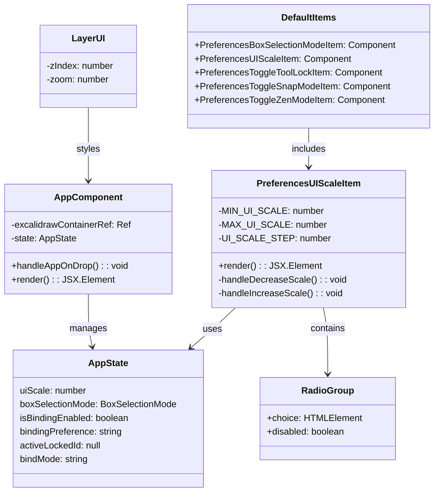
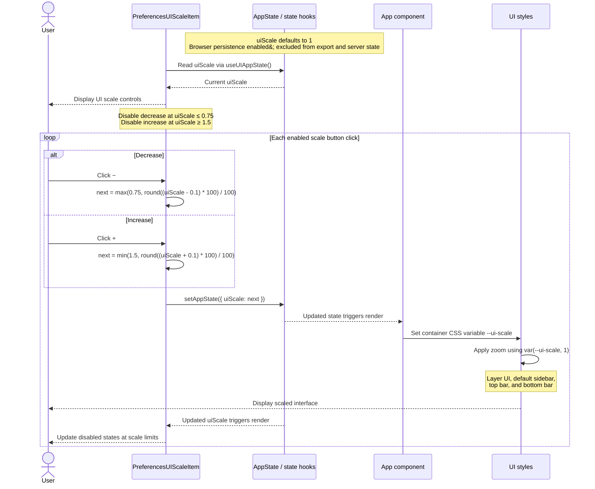

# Issue #7 -- Add a HUD size slider to preferences.

## Class Diagram

## Sequence Diagram

## Q&A

**Class diagram:**

1. Among all the classes shown in the diagram, which 1--2 are most central to understanding the codebase and solving the issue? Explain what role each one plays.

The most central classes to understanding the codebase and solving the issue are AppState and PreferencesUIScaleItem. AppState holds the uiScale value, and PreferencesUIScaleItem contains the handleIncreaseScale() and handleDecreaseScale() functions.

2. What is the most significant relationship shown in the diagram? Explain what it represents in the system and why it matters for understanding the solution.

The most significant relationship shown in the diagram is that PreferencesUIScaleItem "uses" AppState. This shows how the handleIncreaseScale() and handleDecreaseScale() functions update the uiScale value.

3. Looking back at your implementation, is there anything in this design you would change, and why?

I don't think I would change anything with my implementation, everything is encapsulated well and interacts in a meaningful and well-implemented way.

**Sequence diagram:**

1. What user action or system event starts the sequence, and what is the expected outcome when it completes successfully?

The user action that starts the sequence is clicking the "+" or "-" buttons in the preferences menu, and the expected outcome is that the UI should zoom in or out.

2. Identify the 2--3 most important steps in the sequence. For each one, describe what is happening and note whether it involves existing code or new/modified code from your solution.

The two most important steps in the sequence are "setAppState({ uiScale: next })" and "Set container CSS variable --ui-scale". The "setAppState({ uiScale: next })" step updates the uiScale in AppState and the "Set container CSS variable --ui-scale" step updates the CSS for all of the UI elements.

3. What error cases or alternative paths are not shown in the diagram, and why did you leave them out? I left out the text localization, because while it is important to the UI, it isn't really relevant to the feature itself.

**Cross-cutting:**

4. If you used AI to create or check any part of the diagrams, describe what it produced, what you verified against the actual code, and what you had to correct or add. If AI was not used, write "N/A."

I used Mermaid to generate the diagrams, and I was suprised at how well it was at creating accurate diagrams. I used the diff and the actual Excalidraw repository as part of my prompt, and because of this, when I verified the diagram against the code, I didn't have to make any changes.
